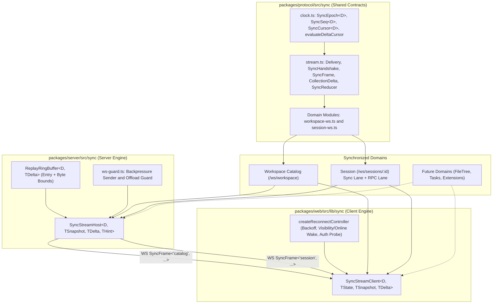
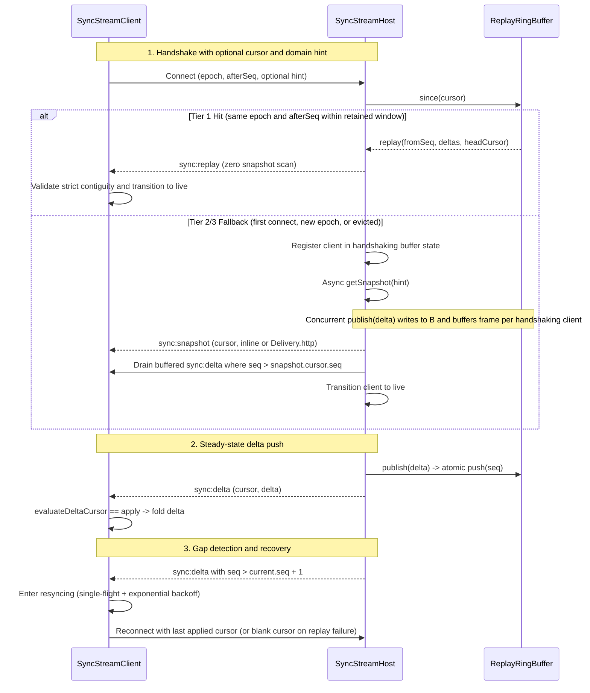
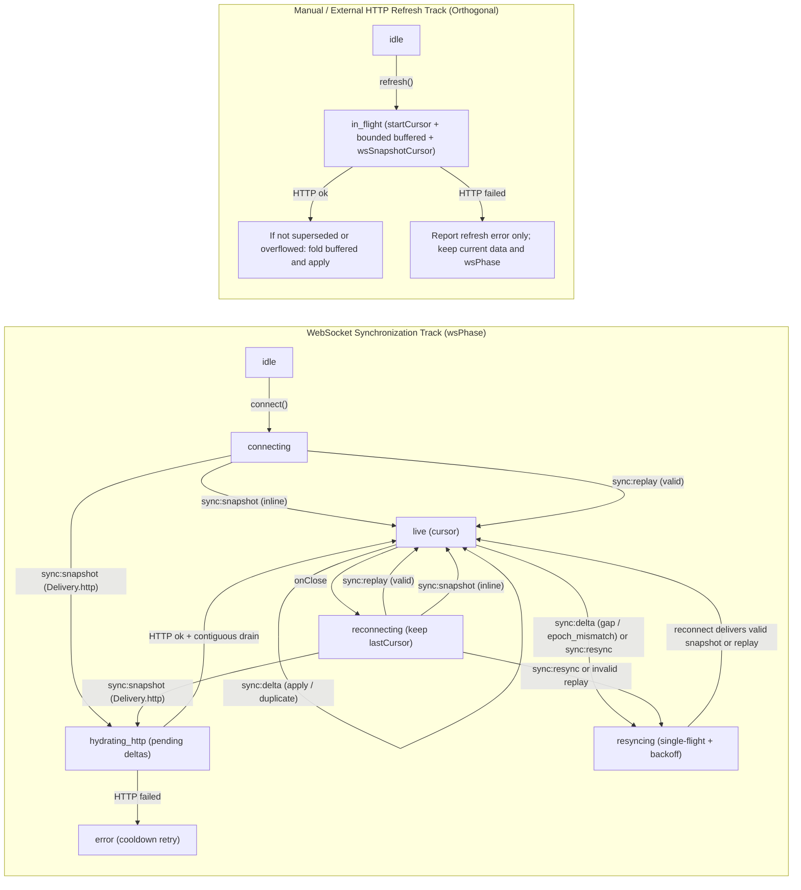

# Versioned Incremental Synchronization Design

## 1. Purpose and Design Principles

Real-time views in Pivia replicate server state over WebSockets and recover state across disconnects, server restarts, and large payloads. This document defines the unified synchronization architecture shared by `packages/protocol`, `packages/server`, and `packages/web`.

The design follows five principles:

1. **Single monotonic clock per stream**: Every synchronized resource owns one logical clock `(SyncEpoch<D>, SyncSeq<D>)`. Every state mutation in that domain advances `seq` by one and enters the replay buffer in causal order.
2. **Orthogonal Sync and RPC planes**: Server-to-client state replication (`sync:*`) and client-to-server control commands (`rpc:*`) share a WebSocket transport without sharing sequence numbers or queuing semantics.
3. **Transparent payload offloading**: Any snapshot or delta field that can exceed WebSocket size budgets uses `Delivery<T, THttpMeta>` to switch cleanly between `inline` JSON frames and compressed HTTP fetches.
4. **Compile-time domain isolation**: Phantom-branded `SyncEpoch<D>`, `SyncSeq<D>`, and `SyncCursor<D>` prevent mixing cursors across domains (for example, passing a `"session"` sequence to `"catalog"`).
5. **Strict gap detection and deterministic recovery**: Clients accept sequential deltas (`incoming.seq === current.seq + 1`), ignore duplicates (`incoming.seq <= current.seq`), and trigger bounded resynchronization on gaps (`incoming.seq > current.seq + 1`) or epoch changes.

---

## 2. System Architecture

### 2.1 Layered Architecture



### 2.2 Domain Mapping

| Dimension                | Workspace Catalog (`/ws/workspace`)                                                             | Session (`/ws/sessions/:id`, Sync Lane)                                                                                             | Future Domains (FileTree, Tasks)                |
| :----------------------- | :---------------------------------------------------------------------------------------------- | :---------------------------------------------------------------------------------------------------------------------------------- | :---------------------------------------------- |
| **Domain `D`**           | `"catalog"`                                                                                     | `"session"`                                                                                                                         | `"fs"` / `"tasks"`                              |
| **Handshake `THint`**    | `undefined`                                                                                     | `SessionPrefixAnchor` (Tier 2 prefix slice)                                                                                         | Optional path or ETag                           |
| **Snapshot `TSnapshot`** | `{ sessions: SessionSummary[]; updatedAtMs: number }`                                           | `{ entriesVersion, baseEntryCount, entries: Delivery<FileEntry[], SessionEntriesHttpMeta>, state, liveMessage, pendingUiRequests }` | Domain snapshot with optional `Delivery` fields |
| **Delta `TDelta`**       | `CollectionDelta<SessionId, SessionSummary, SessionSummaryPatch>` (`upsert`, `patch`, `remove`) | Union: `agent_event`, `entries_appended` (with `Delivery`), `state_patched`, `ui_request`, `ui_resolved`, `extension_error`         | `CollectionDelta` or custom delta union         |
| **RPC Lane**             | None                                                                                            | Orthogonal frames: `rpc:command`, `rpc:ui_response`, `rpc:response`, `rpc:error`                                                    | Optional                                        |
| **Server Engine**        | `SyncStreamHost`                                                                                | `SyncStreamHost`                                                                                                                    | `SyncStreamHost`                                |
| **Client Engine**        | `SyncStreamClient`                                                                              | `SyncStreamClient`                                                                                                                  | `SyncStreamClient`                              |

### 2.3 Synchronization Lifecycle Sequence



---

## 3. Core Protocol Specification (`packages/protocol`)

### 3.1 Logical Clock and Cursor Semantics (`clock.ts`)

```ts
declare const SyncDomainBrand: unique symbol;

/** Domain-scoped epoch identifier that changes whenever server or runtime state resets. */
export type SyncEpoch<D extends string> = string & {
    readonly [SyncDomainBrand]: { readonly domain: (domain: D) => D; readonly kind: "epoch" };
};

/** Non-negative safe integer sequence strictly monotonic within one SyncEpoch<D>. */
export type SyncSeq<D extends string> = number & {
    readonly [SyncDomainBrand]: { readonly domain: (domain: D) => D; readonly kind: "seq" };
};

/** Logical clock cursor pairing a domain epoch with its sequence number. */
export interface SyncCursor<D extends string> {
    readonly epoch: SyncEpoch<D>;
    readonly seq: SyncSeq<D>;
}

export function initialSyncSeq<D extends string>(): SyncSeq<D> {
    return 0 as SyncSeq<D>;
}

export function parseSyncEpoch<D extends string>(raw: unknown): SyncEpoch<D> | null {
    return typeof raw === "string" && raw.length > 0 ? (raw as SyncEpoch<D>) : null;
}

export function parseSyncSeq<D extends string>(raw: unknown): SyncSeq<D> | null {
    return typeof raw === "number" && Number.isSafeInteger(raw) && raw >= 0 ? (raw as SyncSeq<D>) : null;
}

export function parsePositiveSyncSeq<D extends string>(raw: unknown): SyncSeq<D> | null {
    return typeof raw === "number" && Number.isSafeInteger(raw) && raw >= 1 ? (raw as SyncSeq<D>) : null;
}

export function parseSyncSeqString<D extends string>(raw: unknown): SyncSeq<D> | null {
    if (typeof raw !== "string" || !/^\d+$/.test(raw)) {
        return null;
    }
    const parsed = Number(raw);
    return Number.isSafeInteger(parsed) ? (parsed as SyncSeq<D>) : null;
}

export function nextSyncSeq<D extends string>(seq: SyncSeq<D>): SyncSeq<D> {
    const next = seq + 1;
    if (!Number.isSafeInteger(next)) {
        throw new RangeError("Sync sequence overflow.");
    }
    return next as SyncSeq<D>;
}

/** Explicit cursor decision that distinguishes normal advance, duplicates, gaps, and epoch changes. */
export type DeltaCursorDecision<D extends string> =
    | { readonly kind: "apply" }
    | { readonly kind: "duplicate" }
    | { readonly kind: "gap"; readonly expectedSeq: SyncSeq<D>; readonly receivedSeq: SyncSeq<D> }
    | { readonly kind: "epoch_mismatch" };

export function evaluateDeltaCursor<D extends string>(
    current: SyncCursor<D>,
    incoming: SyncCursor<D>,
): DeltaCursorDecision<D> {
    if (current.epoch !== incoming.epoch) {
        return { kind: "epoch_mismatch" };
    }
    if (incoming.seq <= current.seq) {
        return { kind: "duplicate" };
    }
    const expectedSeq = nextSyncSeq(current.seq);
    if (incoming.seq === expectedSeq) {
        return { kind: "apply" };
    }
    return { kind: "gap", expectedSeq, receivedSeq: incoming.seq };
}

export function canApplySyncSnapshot<D extends string>(
    current: SyncCursor<D> | null,
    incoming: SyncCursor<D>,
): boolean {
    return current === null || current.epoch !== incoming.epoch || incoming.seq >= current.seq;
}
```

### 3.2 Stream Envelope and Archetypes (`stream.ts`)

```ts
import type { SyncCursor, SyncSeq } from "./clock.ts";

/** Generic payload container that switches transparently between inline WS data and HTTP fetch. */
export type Delivery<T, THttpMeta = { readonly count: number }> =
    { readonly mode: "inline"; readonly data: T } | { readonly mode: "http"; readonly meta: THttpMeta };

/** One delta paired with its monotonic domain sequence number. */
export interface SequencedDelta<D extends string, TDelta> {
    readonly seq: SyncSeq<D>;
    readonly payload: TDelta;
}

/** Client handshake parameters carrying an optional cursor and optional domain-specific hint. */
export interface SyncHandshake<D extends string, THint = undefined> {
    readonly cursor?: SyncCursor<D> | undefined;
    readonly hint?: THint | undefined;
}

/** Standard server-to-client synchronization envelope shared by every SyncStream domain. */
export type SyncFrame<D extends string, TSnapshot, TDelta> =
    | {
          readonly type: "sync:snapshot";
          readonly cursor: SyncCursor<D>;
          readonly snapshot: TSnapshot;
      }
    | {
          readonly type: "sync:replay";
          readonly cursor: SyncCursor<D>;
          readonly fromSeq: SyncSeq<D>;
          readonly deltas: readonly SequencedDelta<D, TDelta>[];
      }
    | {
          readonly type: "sync:delta";
          readonly cursor: SyncCursor<D>;
          readonly delta: TDelta;
      }
    | {
          readonly type: "sync:resync";
          readonly reason: "gap" | "epoch_changed" | "buffer_evicted";
      };

/** Standard archetype for keyed entity collections. */
export type CollectionDelta<TId extends string, TItem, TPatch> =
    | { readonly op: "upsert"; readonly item: TItem }
    | { readonly op: "patch"; readonly id: TId; readonly patch: TPatch }
    | { readonly op: "remove"; readonly id: TId };

/** Pure state reduction contract consumed by SyncStreamClient. */
export interface SyncReducer<TState, TSnapshot, TDelta> {
    applySnapshot(prev: TState, snapshot: TSnapshot): TState;
    applyDelta(prev: TState, delta: TDelta, seq?: number): TState;
}

/**
 * Extended reducer contract for domains whose snapshots or deltas may offload payloads to HTTP.
 */
export interface HydratableSyncReducer<TState, TSnapshot, TDelta, THydration = never> extends SyncReducer<
    TState,
    TSnapshot,
    TDelta
> {
    inspectSnapshot?(snapshot: TSnapshot, state: TState): THydration | null;
    inspectDelta?(delta: TDelta, state: TState): THydration | null;
    recoverHydrationFailure?(prevState: TState, descriptor: THydration, message: string): TState;
}
```

### 3.3 Boundary Parsing Rules

- **Strict compiler compliance**: All optional properties follow `exactOptionalPropertyTypes: true` (`| undefined` declared explicitly and constructed with conditional object spreads).
- **Generic frame decoder (`createSyncFrameParser`)**: Validates `type` (`sync:snapshot`, `sync:replay`, `sync:delta`, `sync:resync`), validates `cursor.epoch` (`parseSyncEpoch<D>`), validates `sync:snapshot` / `sync:replay` `cursor.seq` (`parseSyncSeq<D>`), and validates positive delta sequences (`parsePositiveSyncSeq<D>`, `seq >= 1`) on `sync:delta` and `sync:replay.deltas`, then delegates payload validation to domain decoders.
- **Replay frame wire check**: Rejects `sync:replay` payloads where any delta has a non-monotonic sequence or falls outside `(fromSeq, cursor.seq]`.
- **Handshake query parsing (`parseSyncHandshakeQuery`)**: Accepts `epoch` and `afterSeq` query parameters. Missing or malformed cursor parameters degrade to `cursor: undefined` so the server falls back to a full snapshot instead of failing the upgrade.

### 3.4 Invariant Allocation

| Domain Invariant                                                   | Enforcement Level       | Mechanism                                                                                                                                             |
| :----------------------------------------------------------------- | :---------------------- | :---------------------------------------------------------------------------------------------------------------------------------------------------- |
| No cross-domain `epoch` or `seq` mixing                            | **Compile time**        | Phantom-branded `SyncEpoch<D>`, `SyncSeq<D>`, and `SyncCursor<D>`                                                                                     |
| No boolean blindness on cursor checks; brand preserved on `gap`    | **Compile time**        | Four-variant `DeltaCursorDecision<D>` (`apply`, `duplicate`, `gap`, `epoch_mismatch`)                                                                 |
| No illegal `pending` buffer outside snapshot/hydration phases      | **Compile time**        | Discriminated `SyncPhase` union where `pending` exists only in buffering variants                                                                     |
| No confusion between Sync lane and RPC lane frames                 | **Compile time**        | Explicit `sync:*` and `rpc:*` discriminants checked with `assertNever`                                                                                |
| Valid `epoch`, `seq`, and `hint` from untrusted JSON or WS queries | **Boundary parse time** | `parseSyncEpoch<D>`, `parseSyncSeq<D>`, `parseSyncSeqString<D>`, `parseSyncHandshakeQuery`, `createSyncFrameParser`                                   |
| Strict `seq` contiguity per `epoch` even with zero subscribers     | **Runtime + Tests**     | `SyncStreamHost.publish()` always pushes to `ReplayRingBuffer` first; terminal close awaits disk check and publishes via `publishSessionClosed()`     |
| Linearizable snapshots across async disk discovery and closes      | **Runtime + Tests**     | `SessionRegistry.list()` retries when `closeVersion` changes; `SyncStreamHost` runs Subscribe-before-Snapshot + watermark drain                       |
| Client gap detection, replay integrity, and storm protection       | **Runtime + Tests**     | `evaluateDeltaCursor`, 4-point `sync:replay` verification, and single-flight backoff in `resyncing`                                                   |
| Causal order across Session events, entries, and UI dialogs        | **Runtime + Tests**     | `agent_event`, `entries_appended`, `state_patched`, `ui_request`, `ui_resolved`, and `extension_error` share one `SessionSeq`                         |
| Bounded memory and slow-consumer eviction                          | **Runtime + Tests**     | `Delivery` switches large payloads to `http`; `ReplayRingBuffer` bounds entries and bytes; `createBackpressureSender` closes slow clients with `1013` |

---

## 4. Server Synchronization Engine (`packages/server/src/sync`)

### 4.1 `ReplayRingBuffer<D, TDelta>`

`ReplayRingBuffer` replaces domain-specific ring buffers with one bounded, epoch-scoped store:

- **Identity and cursor**: Holds an immutable `epoch: SyncEpoch<D>` and monotonic `nextSeq` starting at `1` (`currentSeq` is `0` before the first push).
- **Dual retention bounds**:
    - `maxEntries` (default `512`, configurable per host for testing eviction boundaries).
    - Optional `maxBytes` budget measured on serialized delta payloads so large spikes cannot grow heap usage without bound. Eviction drops the oldest entries until both bounds hold.
- **Atomic `push(payload: TDelta)`**: Assigns the next `SyncSeq<D>`, stores `{ seq, payload }`, evicts oldest items if needed, and returns `{ seq, payload }`.
- **`since(cursor?: SyncCursor<D>)`**:
    - Returns `{ kind: "replay", fromSeq: cursor.seq, cursor: headCursor, deltas }` when `cursor.epoch === this.epoch`, `cursor.seq <= currentSeq`, and `cursor.seq >= earliestSeq - 1`. When `cursor.seq === currentSeq`, `deltas` is empty so up-to-date reconnects require zero snapshot work.
    - Returns `{ kind: "snapshot_required", cursor: headCursor }` otherwise.

### 4.2 `SyncStreamHost<D, TSnapshot, TDelta, THint>`

`SyncStreamHost` owns the subscription lifecycle, replay handshake, async snapshot serialization window, and fan-out for one domain stream:

- **`publish(delta: TDelta)`**:
    1. Calls `buffer.push(delta)` unconditionally, even when `clients.size === 0`, guaranteeing zero sequence gaps during disconnected intervals.
    2. If `clients.size === 0`, returns immediately without serializing JSON.
    3. Serializes the `sync:delta` frame once.
    4. Iterates over active clients:
        - Clients in `handshaking` push `{ seq, raw }` into their per-client `pending` array (capped at `DEFAULT_MAX_HANDSHAKE_PENDING = 512`; if exceeded, the host deletes the client, skips sending the stale snapshot, emits `sync:resync` (`buffer_evicted`), and closes the transport with `SESSION_CLOSE_CODE.normal` so non-compliant peers cannot leak).
        - Clients in `live` send `raw` immediately through `createBackpressureSender`.
- **`attach(client, handshake)`**:
    1. **Tier 1 check**: If `handshake.cursor` is present, calls `buffer.since(handshake.cursor)`. On `{ kind: "replay" }`, sends one `sync:replay` frame synchronously and registers the client directly in `live` state.
    2. **Tier 2/3 snapshot path**: Registers the client in `handshaking` state _before_ awaiting `getSnapshot(handshake.hint)` so deltas published during async snapshot construction are captured in `pending`.
    3. When `getSnapshot` resolves with `{ snapshot, cursor }`:
        - If the client already closed, aborts cleanly.
        - Sends `sync:snapshot`.
        - Drains `pending` frames strictly with `item.seq > cursor.seq`.
        - Transitions the client to `live` and clears `pending`.
- **Lifecycle**: Tracks active clients, exposes `subscriberCount` and `dispose()`, and closes clients cleanly on host shutdown.

### 4.3 Backpressure and Payload Size Guard (`ws-guard.ts`)

- **`createBackpressureSender`**: Wraps raw WebSocket writes and checks `socket.bufferedAmount > maxBufferedBytes` (`MAX_WS_BUFFERED_BYTES = 4 MiB`). Exceeding the limit closes the socket immediately with `SESSION_CLOSE_CODE.slowConsumer` (`1013`), preventing stalled mobile links from accumulating stale deltas.
- **`shouldOffloadPayload`**: Evaluates count thresholds (`MAX_WS_INLINE_ENTRY_COUNT`) and UTF-8 serialized byte thresholds (`MAX_WS_INLINE_ENTRIES_BYTES`) uniformly before embedding payloads in `sync:snapshot` or `sync:delta`. Oversized payloads emit `{ mode: "http", meta }` so clients fetch compressed payloads over HTTP without blocking WebSocket heartbeats or live deltas.

---

## 5. Client Synchronization Engine (`packages/web/src/lib/sync`)

### 5.1 Orthogonal State Model



Keeping the manual HTTP refresh track independent of `wsPhase` ensures two invariants:

1. A failed manual refresh (`GET /api/sessions`) reports an error without resetting a healthy `live` WebSocket cursor or discarding deltas received while the HTTP request was in flight.
2. Background `resyncing` keeps existing UI rows visible and never triggers full-screen loading skeletons reserved for initial empty loads.

### 5.2 `SyncStreamClient` Transition and Validation Rules

- **Inline `sync:snapshot` in `connecting`, `reconnecting`, `resyncing`, or `live`**:
    - Verified with `canApplySyncSnapshot(currentCursor, frame.cursor)`.
    - If `connecting` or `resyncing` holds a newer same-epoch cursor from a completed external refresh (`!canApplySyncSnapshot(currentCursor, frame.cursor)`), keeps the newer state/cursor and activates `live` directly when the snapshot does not require HTTP hydration (or forces `enterResyncing("gap", null)` if it does).
    - Otherwise calls `reducer.applySnapshot(state, frame.snapshot)`, updates `cursor`, and enters `live` directly.
- **`sync:snapshot` or `sync:delta` / `sync:replay` carrying `Delivery.http`**:
    - `HydratableSyncReducer.inspectSnapshot` or `inspectDelta` returns a descriptor, switching the client into `hydrating_http` with `committedCursor` (the last fully hydrated cursor: `null` for snapshot, or the prior sequence for an inline delta) and buffering subsequent `sync:delta` frames into a bounded `pending` queue (capped at `DEFAULT_MAX_PENDING_DELTAS`, `512`).
    - If the connection closes during `hydrating_http`, `markReconnecting` preserves `committedCursor` rather than `targetCursor` so reconnect replays from before the unhydrated offload.
    - If `pending` overflows during a slow HTTP fetch, `SyncStreamClient` sets `pendingOverflow = true` and drops the queue instead of growing memory without limit.
    - Once HTTP hydration completes: drains `pending` entries (or pauses drain to hydrate another nested `Delivery.http` delta). If `pendingOverflow` is true or a gap appears inside `pending`, triggers a bounded resync with `resumeCursor = null`.
    - When `recoverHydrationFailure` is defined and `onHydrateHttp` rejects, recovers to non-blocking `live` state while draining `pending` deltas, records `failedHydration` so in-session retry works via `retryHydration()`, and makes `handshakeCursor()` return `undefined` on disconnect so reconnect reloads a complete Tier 2/3 snapshot instead of replaying past unhydrated history.
- **Orthogonal external HTTP refresh coordination**:
    - `beginExternalRefresh()` records `startCursor`; `completeExternalRefresh(snapshot, cursor)` rejects stale-epoch HTTP responses against an active `live` epoch, `wsSnapshotCursor`, or `startCursor` epoch switch, discards overflowed refresh buffers (> `maxPendingDeltas`), and folds only same-epoch buffered deltas newer than `cursor`.
- **Strict 4-point `sync:replay` verification**:
  A `sync:replay` frame is accepted only if all four checks pass:
    1. `lastCursor !== null`.
    2. `frame.cursor.epoch === lastCursor.epoch`.
    3. `frame.fromSeq === lastCursor.seq`.
    4. `frame.deltas` advances strictly by `1` from `lastCursor.seq + 1` and ends at `frame.cursor.seq` (or `frame.deltas` is empty and `frame.cursor.seq === lastCursor.seq`).
       Any failed check discards the replay and triggers `resyncing` with `cursor: undefined` (requesting a fresh snapshot).
- **`sync:delta` in `live`**:
  Evaluated by `evaluateDeltaCursor(currentCursor, frame.cursor)`:
    - `"apply"`: calls `reducer.applyDelta` and advances `cursor`.
    - `"duplicate"`: no-op.
    - `"gap"` or `"epoch_mismatch"`: logs `expectedSeq` and `receivedSeq`, transitions to `resyncing`, and triggers recovery.
- **Resync storm protection**:
  `resyncing` enforces single-flight execution and exponential backoff via `createReconnectController` (first gap can recover immediately; repeated gaps within the cooldown window back off exponentially to avoid server scan storms).

### 5.3 `createReconnectController`

Shared connection lifecycle controller used across WebSocket streams:

- Exponential backoff schedule (`[1_000, 2_000, 4_000, 8_000, 15_000]` ms by default).
- Optional `maxAttempts` (`Infinity` for Workspace Catalog; finite retry limit for Session unless woken by user or visibility).
- Automatic immediate reconnect trigger on `visibilitychange` (tab becomes visible) and `online` browser events when disconnected.
- Optional `authProbe` invoked after `authProbeFailureThreshold` consecutive transport closes so expired sessions transition cleanly to the auth gate instead of looping on `401` upgrades.
- Explicit `stop()` cancels all timers and prevents stale callbacks after unmount or session switch.

### 5.4 Local Cache (IndexedDB / Memory LRU) Decoupling

Local caches provide stale-while-revalidate (SWR) instant rendering before the first network handshake completes, but never fabricate live synchronization state:

- Hydrating Workspace Catalog from IndexedDB populates rows and `updatedAtMs` while leaving `catalogCursor: null` and `wsPhase: "connecting"` or `"idle"`.
- Hydrating a Session from IndexedDB or memory LRU supplies `SessionPrefixAnchor` for Tier 2 handshake slicing (`entriesVersion`, `afterCount`, `afterEntryId`), while `cursor` stays `null` (and `handshakeCursor()` stays `undefined`, reserving Tier 1 `cursor` for same-session transport reconnects that keep `liveMessage` and `pendingUiRequests` in memory) and `liveMessage` starts empty (`{ kind: "none" }`) until the WebSocket handshake confirms authoritative runtime state.

---

## 6. Domain Specifications

### 6.1 Workspace Catalog (`/ws/workspace`)

- **Domain types**: `CatalogEpoch = SyncEpoch<"catalog">`, `CatalogSeq = SyncSeq<"catalog">`, `CatalogCursor = SyncCursor<"catalog">`.
- **Messages**:
    - `CatalogSnapshot`: `{ sessions: readonly SessionSummary[]; updatedAtMs: number }`.
    - `CatalogDelta`: `CollectionDelta<SessionId, SessionSummary, SessionSummaryPatch>`.
    - `WorkspaceWsServerMessage = SyncFrame<"catalog", CatalogSnapshot, CatalogDelta>`.
- **Snapshot linearization (`SessionRegistry.list()`)**:
  Because `SessionCatalog.list()` scans `.jsonl` files asynchronously while sessions may close concurrently, `SessionRegistry` maintains a monotonic `closeVersion` counter incremented synchronously on every `this.active.delete(...)`. `list()` records `versionBefore = this.closeVersion` before `await this.catalog.list()`; if `this.closeVersion !== versionBefore` when the scan finishes, it retries (up to `MAX_LIST_RETRIES = 2`) before merging active runtimes and stamping the current `catalogCursor`. This prevents a concurrent close from producing a snapshot stamped with a newer `catalogSeq` that omits a newly persisted session or keeps stale disk state. Both `GET /api/sessions` and WebSocket `getSnapshot()` share this guarantee.
- **Synchronous close-event ordering**:
  `closeSessionInternal` and `failRuntime` in `SessionRegistry` await `resolvePersistedOnClose` before deleting from `active` and publishing the terminal delta via `publishSessionClosed(sessionId, persisted)` inside `finalizeClosedEntry` before resolving `closePromise`. This guarantees `closeSession()` callers and any `open(sessionId)` waiting on `closePromise` always observe the published terminal delta (`patch` to `idle` if persisted on disk, or `remove` if unflushed) in `ReplayRingBuffer`.
- **Store side effects**:
  When `sync:snapshot` is applied, the workspace store prunes `pins` and `selectedId` to existing session IDs and writes the snapshot to IndexedDB. When a `remove` delta is applied (either live or inside `sync:replay`), it removes the matching ID from `pins` and `selectedId`.
- **External disk edit trade-off**:
  Tier 1 `sync:replay` reconnects Catalog over transient network drops without rescanning the filesystem. Edits made directly on disk by an external CLI appear on manual `refresh()` or through a future debounced file watcher feeding `SyncStreamHost.publish()`.

### 6.2 Session (`/ws/sessions/:id`)

#### Sync Lane

- **Domain types**: `SessionRuntimeId = SyncEpoch<"session">`, `SessionSeq = SyncSeq<"session">`, `SessionCursor = SyncCursor<"session">`.
- **Handshake**: Accepts optional `?epoch=<SessionRuntimeId>&afterSeq=<SessionSeq>` and optional `SessionPrefixAnchor` (`entriesVersion`, `afterCount`, `afterEntryId`).
- **Payload structures**:

```ts
export interface SessionEntriesHttpMeta {
    readonly entryCount: number;
}

export interface SessionSnapshot {
    readonly entriesVersion: EntriesVersion;
    readonly baseEntryCount: number;
    readonly entries: Delivery<readonly FileEntry[], SessionEntriesHttpMeta>;
    readonly state: SessionStateSnapshot;
    readonly liveMessage: AssistantMessage | null;
    readonly pendingUiRequests: readonly RpcExtensionUIRequest[];
}

export interface SessionStatePatch {
    readonly model?: SessionModelInfo | null | undefined;
    readonly messageCount?: number | undefined;
    readonly autoCompactionEnabled?: boolean | undefined;
    readonly steeringMode?: QueueMode | undefined;
    readonly followUpMode?: QueueMode | undefined;
}

export type SessionDelta =
    | { readonly kind: "agent_event"; readonly event: JsonAgentSessionEvent }
    | {
          readonly kind: "entries_appended";
          readonly entriesVersion: EntriesVersion;
          readonly baseEntryCount: number;
          readonly entries: Delivery<readonly FileEntry[], SessionEntriesHttpMeta>;
      }
    | { readonly kind: "state_patched"; readonly patch: SessionStatePatch }
    | { readonly kind: "ui_request"; readonly request: RpcExtensionUIRequest }
    | { readonly kind: "ui_resolved"; readonly requestId: string }
    | {
          readonly kind: "extension_error";
          readonly extensionPath: string;
          readonly event: string;
          readonly error: string;
      };
```

- **Causal unification**:
    - `agent_event`, `entries_appended`, `state_patched`, `ui_request`, `ui_resolved`, and `extension_error` all pass through `SyncStreamHost.publish()` on the same `SessionSeq`.
    - Tier 1 `sync:replay` replays all six delta kinds in exact causal order, removing the need for a separate `appendedSlice` field on replay frames.
    - Large `entries_appended` batches are evaluated by `shouldOffloadPayload`. When offloaded, the `ReplayRingBuffer` stores only the compact `{ mode: "http", meta: { entryCount } }` descriptor (`baseEntryCount` lives once on the enclosing `entries_appended` or `SessionSnapshot` object), preserving buffer memory while keeping causal order.
    - Client-side `hydrating_http` replaces bespoke `pendingAppendedEntries` queuing in the session reducer: when `sync:snapshot` or `entries_appended` carries `Delivery.http`, `SyncStreamClient` buffers subsequent deltas and drains them strictly after `GET /api/sessions/:id` resolves (skipping redundant HTTP requests when `entriesVersion` and `entries.length` already satisfy `meta.entryCount`).

#### RPC Lane

- **Client-to-server (`SessionWsClientMessage`)**:
    - `{ readonly type: "rpc:command"; readonly command: SessionCommand }` (serialized through the per-socket command chain, waiting on `readyPromise` while `starting`).
    - `{ readonly type: "rpc:ui_response"; readonly response: RpcExtensionUIResponse }` (dispatched out of band so dialog answers unblock long-running prompts or compactions immediately).
- **Server-to-client (`SessionRpcServerMessage`)**:
    - `{ readonly type: "rpc:response"; readonly id?: string | undefined; readonly command: SessionWsCommandName; readonly success: true; readonly data?: unknown }`
    - `{ readonly type: "rpc:response"; readonly id?: string | undefined; readonly command: SessionWsCommandName; readonly success: false; readonly error: string }`
    - `{ readonly type: "rpc:error"; readonly code?: string | undefined; readonly message: string; readonly id?: string | undefined }`
- **Socket routing**: `SessionSocket` routes inbound frames starting with `sync:` to `SyncStreamClient` and routes `rpc:response` / `rpc:error` to the command correlation map.

---

## 7. Integration Guide

This section shows how to integrate a new real-time domain (using `"tasks"` as an example) across `packages/protocol`, `packages/server`, and `packages/web`.

### 7.1 Define the Protocol Contract (`packages/protocol`)

Choose a unique domain tag `D`, define the snapshot and delta shapes (using `CollectionDelta` for keyed entities or a custom discriminated union), and build a boundary decoder with `createSyncFrameParser`:

```ts
import type { CollectionDelta, SyncCursor, SyncEpoch, SyncFrame, SyncSeq } from "./sync/index.ts";
import { createSyncFrameParser } from "./sync/parse.ts";

export type TaskSyncEpoch = SyncEpoch<"tasks">;
export type TaskSyncSeq = SyncSeq<"tasks">;
export type TaskSyncCursor = SyncCursor<"tasks">;

export interface TaskItem {
    readonly id: string;
    readonly title: string;
    readonly status: "queued" | "running" | "done";
}

export interface TaskPatch {
    readonly status?: TaskItem["status"] | undefined;
}

export interface TasksSnapshot {
    readonly tasks: readonly TaskItem[];
    readonly updatedAtMs: number;
}

export type TasksDelta = CollectionDelta<string, TaskItem, TaskPatch>;
export type TasksWsServerMessage = SyncFrame<"tasks", TasksSnapshot, TasksDelta>;

export const parseTasksWsServerMessage = createSyncFrameParser<"tasks", TasksSnapshot, TasksDelta>({
    parseSnapshot: parseTasksSnapshot,
    parseDelta: parseTasksDelta,
});
```

If the domain carries large payloads, wrap those fields in `Delivery<T, THttpMeta>`. If the domain supports Tier 2 slice recovery, define a handshake `THint` and pass a hint parser to `parseSyncHandshakeQuery`.

### 7.2 Host the Stream on the Server (`packages/server`)

Instantiate a `ReplayRingBuffer` and a `SyncStreamHost` for the domain, push every state change unconditionally through `host.publish(delta)`, and attach WebSocket connections using `parseSyncHandshakeQuery` and `createBackpressureSender`:

```ts
const epoch = parseSyncEpoch<"tasks">(randomUUID());
if (epoch === null) {
    throw new Error("Generated invalid sync epoch.");
}

const tasksBuffer = new ReplayRingBuffer<"tasks", TasksDelta>({
    epoch,
    maxEntries: 512,
});

const tasksHost = new SyncStreamHost<"tasks", TasksSnapshot, TasksDelta>({
    buffer: tasksBuffer,
    getSnapshot: async () => {
        // Linearize disk scans or concurrent writes before reading currentCursor so the
        // snapshot never carries a newer seq than the mutations reflected in pending deltas.
        const snapshot = await taskService.listLinearizedSnapshot();
        return {
            cursor: tasksBuffer.currentCursor,
            snapshot,
        };
    },
});

// On every domain mutation (even when subscriberCount === 0):
tasksHost.publish({ op: "patch", id: taskId, patch: { status: "done" } });

// Inside the Fastify WebSocket route handler:
const handshake = parseSyncHandshakeQuery<"tasks">(request.query);
const sender = createBackpressureSender(socket, request.log);
const detach = tasksHost.attach(sender, handshake);
socket.on("close", detach);
```

### 7.3 Consume the Stream on the Client (`packages/web`)

Implement `SyncReducer` (or reuse `createCollectionSyncReducer` for `CollectionDelta`), then connect `SyncStreamClient` and `createReconnectController` to the WebSocket transport:

```ts
const tasksReducer = createCollectionSyncReducer<readonly TaskItem[], TasksSnapshot, string, TaskItem, TaskPatch>({
    getItems: (snapshot) => snapshot.tasks,
    getId: (task) => task.id,
    applyPatch: (task, patch) => ({
        ...task,
        ...(patch.status !== undefined ? { status: patch.status } : {}),
    }),
    itemsEqual: (a, b) => a.title === b.title && a.status === b.status,
    fromItems: (_prev, items) => items,
    toItems: (state) => state,
});

const syncClient = new SyncStreamClient<"tasks", readonly TaskItem[], TasksSnapshot, TasksDelta>({
    initialState: [],
    reducer: tasksReducer,
    onStateChange: (nextTasks, meta) => {
        useTasksStore.getState().setTasks(nextTasks, meta.cursor, meta.phase);
    },
    onResyncRequired: (reason) => {
        reconnectController.scheduleResync(reason);
    },
});
```

If a domain uses `Delivery.http` fields inside its snapshot or deltas, pass an `onHydrateHttp` callback to `SyncStreamClient` so `hydrating_http` buffers live deltas and drains them in sequence order after the HTTP fetch completes.

### 7.4 Integration Checklist

Before you ship a new synchronized domain, verify these five rules:

1. **Unconditional `publish`**: Call `host.publish(delta)` on every mutation even when zero clients are connected, so `ReplayRingBuffer` holds a gap-free sequence for reconnecting clients.
2. **Linearized `getSnapshot`**: Ensure async snapshot readers (`getSnapshot`) cannot pair stale disk state with a newer `SyncSeq`. Guard concurrent mutations or retry when state closes during an async scan.
3. **Orthogonal manual refresh**: If the UI supports a manual HTTP refresh button, run it in the separate refresh track so a transient HTTP failure never resets a healthy `live` WebSocket cursor.
4. **No fabricated live cursors from local cache**: Hydrate IndexedDB or memory caches for instant initial display only, leaving `cursor: null` until the WebSocket handshake returns an authoritative `sync:snapshot` or `sync:replay`.
5. **Compiler-checked boundaries**: Keep `exactOptionalPropertyTypes: true` (`| undefined` on optional fields), validate untrusted frames once at the boundary with `createSyncFrameParser`, and terminate union switches with `assertNever`.
