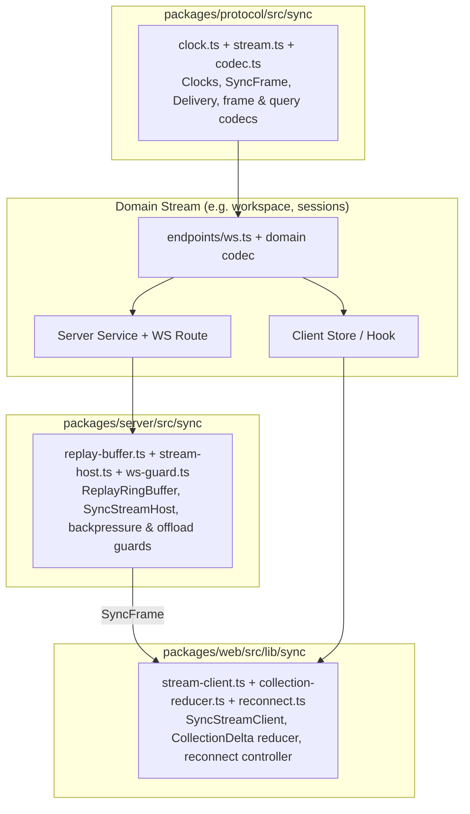
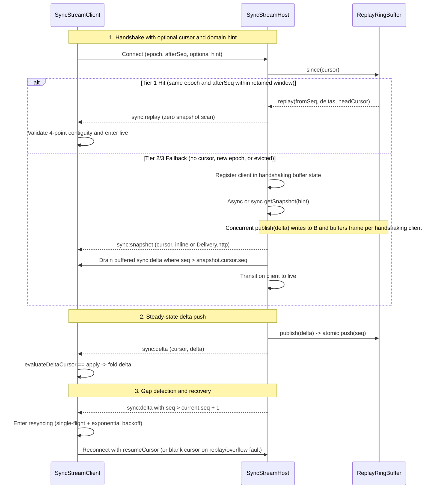
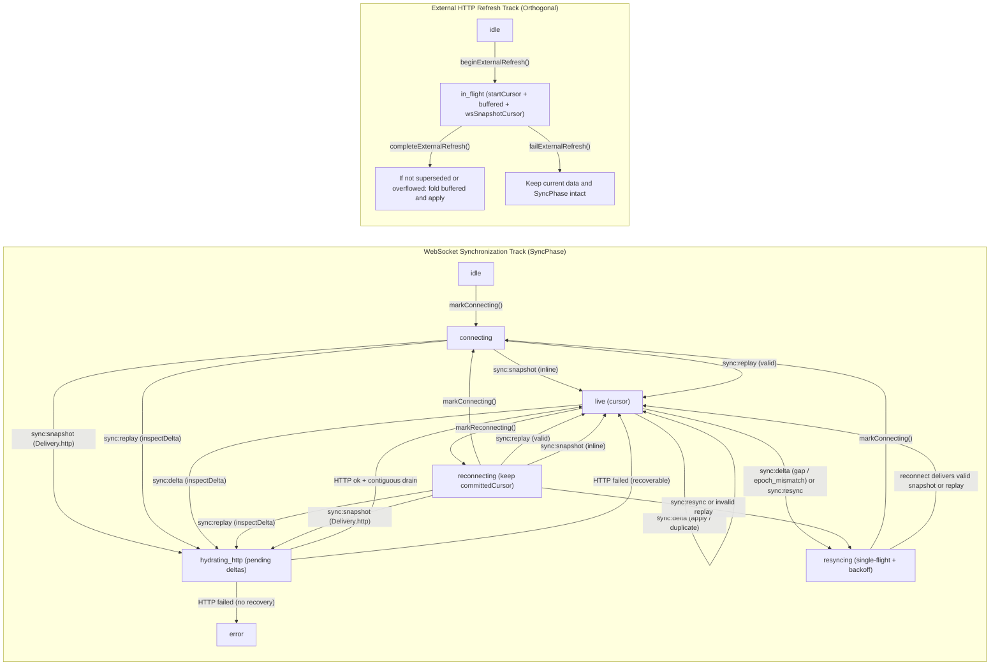

# Versioned Incremental Synchronization

## 1. Purpose and Design Principles

Real-time views in Pivia replicate server state over WebSockets and recover state across disconnects, server restarts, and large payloads. This document explains the shared synchronization engine across `packages/protocol`, `packages/server`, and `packages/web`.

The design follows five principles:

1. **Single monotonic clock per stream**: Every synchronized domain stream owns one logical clock `(SyncEpoch<D>, SyncSeq<D>)`. Each state mutation increments `seq` by `1` (`0` is reserved for empty snapshots and `fromSeq` anchors; deltas start at `1`) and enters the replay buffer in causal order.
2. **Compile-time domain isolation**: Phantom-branded `SyncEpoch<D>`, `SyncSeq<D>`, and `SyncCursor<D>` prevent mixing cursors between domains. `evaluateDeltaCursor` returns a four-variant `DeltaCursorDecision<D>` (`apply`, `duplicate`, `gap`, `epoch_mismatch`) instead of ambiguous booleans.
3. **Orthogonal Sync and RPC planes**: Server-to-client state replication (`sync:*`) and optional client-to-server control commands (`rpc:*`) can share one WebSocket transport without sharing sequence numbers or queue semantics.
4. **Transparent payload offloading**: Snapshot or delta fields that exceed WebSocket size budgets use `Delivery<T, THttpMeta>` to switch between `{ mode: "inline", data }` and `{ mode: "http", meta }`. Clients fetch offloaded slices over HTTP while buffering newer deltas in order.
5. **Bounded memory and slow-consumer protection**: Server replay buffers cap retained entries and bytes, handshake and hydration pending queues are bounded, and slow WebSocket consumers are closed with `WS_CLOSE_CODE.slowConsumer` (`1013`).

---

## 2. Architecture

The generic synchronization engine splits across three packages and feeds domain streams:

---

## 3. How It Works

### 3.1 Three Recovery Tiers and Handshake Lifecycle

- **Tier 1 (`sync:replay`)**: On reconnect, the client sends its last committed cursor (`epoch`, `afterSeq`). When `ReplayRingBuffer.since(cursor)` finds the cursor in the current epoch and retained window (`cursor.seq >= earliestSeq - 1`), the server sends one `sync:replay` frame and skips snapshot construction (`deltas` is empty when `cursor.seq === currentSeq`).
- **Tier 2 (hint-assisted `sync:snapshot`)**: When Tier 1 misses and the domain defines a handshake `THint` (for example, a cached prefix anchor), `getSnapshot(hint)` returns only the missing slice.
- **Tier 3 (full `sync:snapshot`)**: When neither a valid cursor nor a usable hint exists, `getSnapshot(undefined)` returns a full snapshot.

### 3.2 Server Engine (`packages/server/src/sync`)

- **`ReplayRingBuffer<D, TDelta>` (`replay-buffer.ts`)**: Holds one immutable `epoch`, assigns monotonic sequence numbers starting at `1` (`currentSeq === 0` before the first push), and enforces `maxEntries` (default `512`) plus optional `maxBytes`. If a single delta exceeds `maxBytes`, it still advances `seq` and clears retained entries so older clients fall back to a snapshot.
- **`SyncStreamHost<D, TSnapshot, TDelta, THint, TCloseCode>` (`stream-host.ts`)**:
    - `publish(delta)` writes to `ReplayRingBuffer` unconditionally—even when `subscriberCount === 0`—so reconnects never observe gaps, while skipping JSON serialization when no clients are attached.
    - `attach(client, handshake)` implements Subscribe-before-Snapshot: if `since()` misses, it registers the client in `handshaking` state _before_ calling `getSnapshot(hint)`, buffers concurrent deltas (up to `maxPendingPerClient`, default `512`), sends `sync:snapshot`, drains buffered deltas with `seq > snapshot.cursor.seq`, and switches to `live`. On handshake buffer overflow, it sends `sync:resync` (`buffer_evicted`) and closes with `WS_CLOSE_CODE.normal`.
    - Async `getSnapshot` implementations must linearize reads so the returned `cursor` matches the exact state inside `snapshot`.
- **Transport Guards (`ws-guard.ts`)**: `createBackpressureSender` closes sockets with `WS_CLOSE_CODE.slowConsumer` (`1013`) when `socket.bufferedAmount > maxBufferedBytes` (`4 MiB` default). `shouldOffloadPayload` checks `MAX_WS_INLINE_ENTRY_COUNT` (`1000`) and `MAX_WS_INLINE_ENTRIES_BYTES` (`512 KiB`).

### 3.3 Client Engine (`packages/web/src/lib/sync`)

Key client rules:

- **Boundary validation (`createSyncFrameParser`)**: Decodes untrusted WebSocket JSON once at the boundary, rejecting malformed cursors, `sync:delta` frames with `seq < 1`, and non-contiguous `sync:replay` frames.
- **4-point `sync:replay` check (`isValidSyncReplay`)**: Accepts `sync:replay` only when `lastCursor !== null`, `frame.cursor.epoch === lastCursor.epoch`, `frame.fromSeq === lastCursor.seq`, and `frame.deltas` advances by `1` from `lastCursor.seq + 1` to `frame.cursor.seq` (or is empty when `frame.cursor.seq === lastCursor.seq`). Any failure enters `resyncing` with `resumeCursor: null`.
- **HTTP hydration (`HydratableSyncReducer`)**: When `inspectSnapshot` or `inspectDelta` returns a non-null descriptor, `SyncStreamClient` enters `hydrating_http`, saves `committedCursor`, and buffers up to `maxPendingDeltas` (`512`) deltas. When `onHydrateHttp` resolves, it drains `pending` in order (or pauses for a nested offloaded delta). If `recoverHydrationFailure` is defined, failures drain `pending` into a non-blocking `live` state, support `retryHydration()`, and make `handshakeCursor()` return `undefined` so reconnect reloads a full snapshot.
- **Orthogonal external HTTP refresh**: `beginExternalRefresh()`, `completeExternalRefresh()`, and `failExternalRefresh()` keep manual HTTP refreshes separate from `SyncPhase` so stale-epoch or failed HTTP responses never corrupt a `live` WebSocket cursor.
- **Reconnection (`createReconnectController`)**: Provides backoff (`[1_000, 2_000, 4_000, 8_000, 15_000]` ms default), optional `maxAttempts`, single-flight `scheduleResync()` storm cooldown, `visibilitychange`/`online` wakeups, and optional `authProbe` (`DEFAULT_AUTH_PROBE_THRESHOLD = 2`).
- **Local cache decoupling**: Local caches may populate initial display state via `hydrateLocalState()` and supply a `THint`, but must leave the sync cursor `null` until an authoritative `sync:snapshot` or `sync:replay` arrives.

---

## 4. How to Add a Synchronized Domain

Wire the protocol contract, server host, and client consumer using this minimal skeleton:

1. **Protocol (`packages/protocol`)**: Define branded `SyncCursor<D>`, snapshot/delta shapes (using `CollectionDelta` or a custom union), a frame decoder via `createSyncFrameParser`, and register the route in `packages/protocol/src/endpoints/ws.ts` (`WS_ENDPOINTS`) using `encodeSyncHandshakeQuery` / `parseSyncHandshakeQuery`. Wrap large slice fields in `Delivery<T, THttpMeta>` with `parseDelivery`.
2. **Server (`packages/server`)**: Create a `ReplayRingBuffer` and `SyncStreamHost`, call `host.publish(delta)` unconditionally on every mutation, and attach sockets with `createBackpressureSender(socket, request.log)` inside the route handler (`const detach = host.attach(sender, WS_ENDPOINTS.<domain>.parseQuery(request.query))`).
3. **Client (`packages/web`)**: Build a `SyncReducer` (or `createCollectionSyncReducer` / `HydratableSyncReducer`), pass it to `SyncStreamClient` paired with `createReconnectController`, and pass `syncClient.handshakeCursor()` into `WS_ENDPOINTS.<domain>.buildPath(...)`.

### Reference Implementations in Repository

- **Keyed collection without HTTP offload (`"catalog"`)**:
    - Protocol: `packages/protocol/src/workspace/ws.ts` and `packages/protocol/src/endpoints/ws.ts` (`WS_ENDPOINTS.workspace`)
    - Server: `packages/server/src/ws/workspace-socket.ts` and `packages/server/src/sessions/runtime.ts`
    - Client: `packages/web/src/stores/workspace/model.ts` and `packages/web/src/pages/Workspace/useWorkspaceSync.ts`
- **Stream with Tier 2 hint, `Delivery.http` offload, and orthogonal RPC lane (`"session"`)**:
    - Protocol: `packages/protocol/src/sessions/ws.ts` and `packages/protocol/src/endpoints/ws.ts` (`WS_ENDPOINTS.session`)
    - Server: `packages/server/src/ws/session-socket.ts` and `packages/server/src/sessions/runtime.ts`
    - Client: `packages/web/src/stores/session/reducer.ts` and `packages/web/src/stores/session/store.ts`

### Extension Checklist

1. **Unconditional `publish`**: Call `host.publish(delta)` on every mutation even when `subscriberCount === 0`, so `ReplayRingBuffer` holds a gap-free history for reconnects.
2. **Linearized `getSnapshot`**: Ensure async `getSnapshot` implementations never pair stale state with a newer `SyncCursor<D>`.
3. **Orthogonal manual refresh**: Run manual HTTP refreshes through `beginExternalRefresh()` / `completeExternalRefresh()` / `failExternalRefresh()` so transient HTTP errors never break a `live` WebSocket cursor.
4. **No fabricated cursors from cache**: Hydrate local caches via `hydrateLocalState()` for display only, keeping the sync cursor `null` until the WebSocket handshake succeeds.
5. **Strict boundaries**: Keep `exactOptionalPropertyTypes: true` (`| undefined` on optional fields), validate inbound frames once with `createSyncFrameParser`, register paths and query codecs in `WS_ENDPOINTS`, and terminate union switches with `assertNever`.
