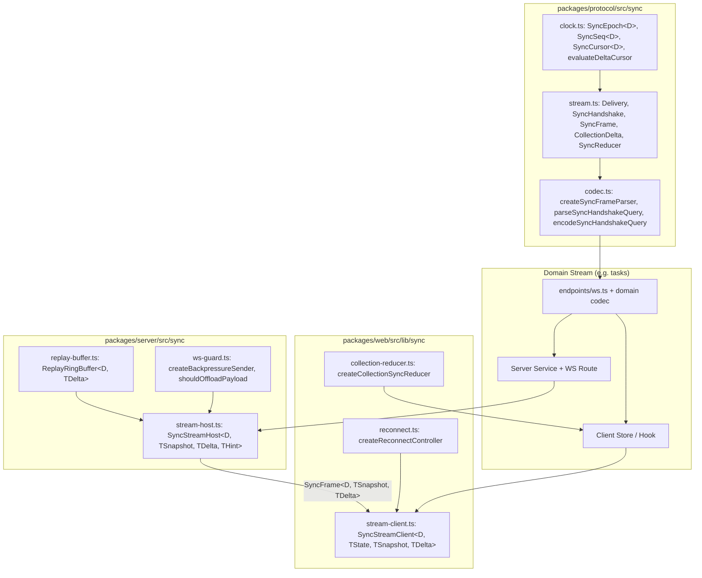
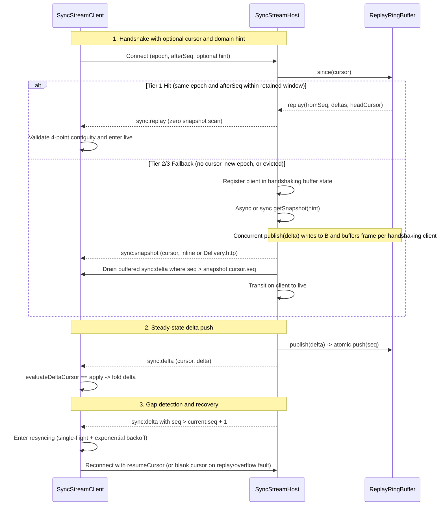
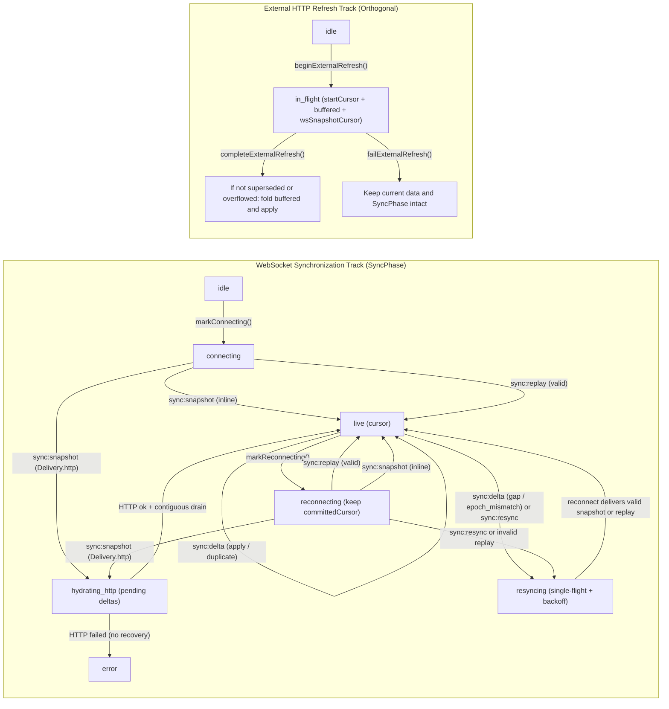

# Versioned Incremental Synchronization

## 1. Purpose and Design Principles

Real-time views in Pivia replicate server state over WebSockets and recover state across disconnects, server restarts, and large payloads. This document explains how the shared synchronization engine is designed, how it works, and how to use and extend it for new domains across `packages/protocol`, `packages/server`, and `packages/web`.

The design follows five principles:

1. **Single monotonic clock per stream**: Every synchronized domain stream owns one logical clock `(SyncEpoch<D>, SyncSeq<D>)`. Each state mutation increments `seq` by `1` (`0` is reserved for empty snapshots and `fromSeq` anchors; deltas start at `1`) and enters the replay buffer in causal order.
2. **Compile-time domain isolation**: Phantom-branded `SyncEpoch<D>`, `SyncSeq<D>`, and `SyncCursor<D>` prevent mixing cursors between domains. `evaluateDeltaCursor` returns a four-variant `DeltaCursorDecision<D>` (`apply`, `duplicate`, `gap`, `epoch_mismatch`) so cursor checks cannot collapse into ambiguous booleans.
3. **Orthogonal Sync and RPC planes**: Server-to-client state replication (`sync:*`) and optional client-to-server control commands (`rpc:*`) can share one WebSocket transport without sharing sequence numbers or queue semantics.
4. **Transparent payload offloading**: Any snapshot or delta field that exceeds WebSocket size budgets uses `Delivery<T, THttpMeta>` to switch between `{ mode: "inline", data }` and `{ mode: "http", meta }`. Clients fetch offloaded slices over HTTP while buffering newer deltas in order.
5. **Bounded memory and slow-consumer protection**: Server replay buffers cap retained entries and bytes, handshake and hydration pending queues are bounded, and slow WebSocket consumers are closed with `WS_CLOSE_CODE.slowConsumer` (`1013`).

---

## 2. Architecture

The generic synchronization engine is split across three packages:



---

## 3. How It Works

### 3.1 Three Recovery Tiers and Handshake Lifecycle



- **Tier 1 (`sync:replay`)**: On reconnect, the client sends its last committed cursor (`epoch`, `afterSeq`). If `ReplayRingBuffer.since(cursor)` finds the cursor within the current epoch and retained window (`cursor.seq >= earliestSeq - 1`), the server sends one `sync:replay` frame and skips snapshot construction. When `cursor.seq === currentSeq`, `deltas` is empty.
- **Tier 2 (hint-assisted `sync:snapshot`)**: When Tier 1 misses and the domain defines a handshake `THint` (for example, a cached prefix anchor), `getSnapshot(hint)` can return only the missing slice.
- **Tier 3 (full `sync:snapshot`)**: When neither a valid cursor nor a usable hint exists, `getSnapshot(undefined)` returns a full snapshot.

### 3.2 Server Engine (`packages/server/src/sync`)

- **`ReplayRingBuffer<D, TDelta>` (`replay-buffer.ts`)**:
    - Holds one immutable `epoch` and assigns strictly monotonic sequence numbers starting at `1` (`currentSeq` is `0` before the first push).
    - Enforces `maxEntries` (default `512`) and an optional `maxBytes` budget over serialized delta payloads, evicting oldest entries until both limits hold. If a single delta exceeds `maxBytes`, it still advances `seq` and clears retained entries so older clients fall back to a snapshot.
- **`SyncStreamHost<D, TSnapshot, TDelta, THint, TCloseCode>` (`stream-host.ts`)**:
    - `publish(delta)` pushes into `ReplayRingBuffer` unconditionally—even when `subscriberCount === 0`—so reconnecting clients never see sequence gaps across idle intervals, while skipping JSON serialization when no clients are attached.
    - `attach(client, handshake)` runs the Subscribe-before-Snapshot protocol: if `since()` misses, the host registers the client in `handshaking` state _before_ calling `getSnapshot(hint)`. Deltas published while `getSnapshot` runs are buffered per client (up to `maxPendingPerClient`, default `512`). After sending `sync:snapshot`, the host drains only buffered deltas with `seq > snapshot.cursor.seq` and moves the client to `live`. If the handshake buffer overflows, the host sends `sync:resync` (`buffer_evicted`) and closes the socket with `WS_CLOSE_CODE.normal`.
    - Note that `getSnapshot` must linearize any async read so the returned `cursor` matches the exact state inside `snapshot`.
- **Transport Guards (`ws-guard.ts`)**:
    - `createBackpressureSender` wraps WebSocket writes and closes slow consumers with `WS_CLOSE_CODE.slowConsumer` (`1013`) when `socket.bufferedAmount > maxBufferedBytes` (`4 MiB` default).
    - `shouldOffloadPayload` checks `MAX_WS_INLINE_ENTRY_COUNT` (`1000`) and `MAX_WS_INLINE_ENTRIES_BYTES` (`512 KiB`) before embedding large slices inline.

### 3.3 Client Engine (`packages/web/src/lib/sync`)

#### State Machine (`SyncStreamClient`)



Key client rules:

- **Boundary validation (`createSyncFrameParser`)**: Untrusted WebSocket JSON is decoded once at the transport boundary. `createSyncFrameParser` rejects malformed cursors, `sync:delta` frames with `seq < 1`, and `sync:replay` frames whose deltas are non-monotonic or fall outside `(fromSeq, cursor.seq]`.
- **4-point `sync:replay` check (`isValidSyncReplay`)**: Accepts `sync:replay` only when `lastCursor !== null`, `frame.cursor.epoch === lastCursor.epoch`, `frame.fromSeq === lastCursor.seq`, and `frame.deltas` advances strictly by `1` from `lastCursor.seq + 1` to `frame.cursor.seq` (or is empty when `frame.cursor.seq === lastCursor.seq`). Any failure triggers `resyncing` with `resumeCursor: null`.
- **HTTP hydration (`HydratableSyncReducer`)**: When `inspectSnapshot` or `inspectDelta` returns a non-null descriptor, `SyncStreamClient` switches to `hydrating_http`, saves `committedCursor` (used if the socket closes before hydration finishes), and buffers incoming deltas up to `maxPendingDeltas` (default `512`). When `onHydrateHttp` resolves, it drains `pending` in sequence order (or pauses to hydrate a nested `Delivery.http` delta). If `recoverHydrationFailure` is defined, hydration failures recover to non-blocking `live` state while draining `pending`, enable in-session retries via `retryHydration()`, and make `handshakeCursor()` return `undefined` so reconnect reloads a full snapshot.
- **Orthogonal external HTTP refresh**: `beginExternalRefresh()`, `completeExternalRefresh()`, and `failExternalRefresh()` keep manual HTTP refreshes separate from `SyncPhase`. A stale-epoch HTTP response is rejected against live WebSocket state, same-epoch deltas received while HTTP was in flight are folded cleanly, and a failed HTTP refresh never resets a healthy `live` cursor.
- **Reconnection (`createReconnectController`)**: Provides exponential backoff (`[1_000, 2_000, 4_000, 8_000, 15_000]` ms by default), optional `maxAttempts`, single-flight `scheduleResync()` storm cooldown, automatic `visibilitychange` and `online` wakeups, and optional `authProbe` after consecutive transport closes (`DEFAULT_AUTH_PROBE_THRESHOLD = 2`).
- **Local cache decoupling**: Local caches (such as IndexedDB) may populate initial display state via `hydrateLocalState()` and supply a domain `THint`, but must leave the sync cursor `null` until an authoritative `sync:snapshot` or `sync:replay` arrives.

---

## 4. How to Use and Extend

To add a new synchronized domain (using `"tasks"` as an example), wire the protocol contract, server host, and client consumer across the three packages.

### 4.1 Define the Protocol Contract (`packages/protocol`)

1. Choose a unique domain literal `D` (for example, `"tasks"`), define the snapshot and delta shapes (reusing `CollectionDelta` for keyed entities or a custom union), and create the frame parser with `createSyncFrameParser` from `packages/protocol/src/sync/codec.ts`:

```ts
import {
    createSyncFrameParser,
    type CollectionDelta,
    type SyncCursor,
    type SyncEpoch,
    type SyncFrame,
    type SyncHandshake,
    type SyncSeq,
} from "../sync/index.ts";

export type TaskSyncEpoch = SyncEpoch<"tasks">;
export type TaskSyncSeq = SyncSeq<"tasks">;
export type TaskSyncCursor = SyncCursor<"tasks">;

export interface TaskItem {
    readonly id: string;
    readonly title: string;
    readonly status: "queued" | "running" | "done";
}

export interface TaskPatch {
    readonly status?: TaskItem["status"] | undefined;
}

export interface TasksSnapshot {
    readonly tasks: readonly TaskItem[];
    readonly updatedAtMs: number;
}

export type TasksDelta = CollectionDelta<string, TaskItem, TaskPatch>;
export type TasksWsServerMessage = SyncFrame<"tasks", TasksSnapshot, TasksDelta>;
export type TasksWsHandshake = SyncHandshake<"tasks">;

export const parseTasksWsServerMessage = createSyncFrameParser<"tasks", TasksSnapshot, TasksDelta>({
    parseSnapshot: parseTasksSnapshot,
    parseDelta: parseTasksDelta,
});
```

2. Register the WebSocket endpoint in `packages/protocol/src/endpoints/ws.ts` (`WS_ENDPOINTS`) using `encodeSyncHandshakeQuery` and `parseSyncHandshakeQuery`. If the domain supports Tier 2 slicing, pass custom `encodeHint` / `parseHint` callbacks; if it offloads large payloads, wrap those fields in `Delivery<T, THttpMeta>` and decode them with `parseDelivery`.

### 4.2 Host the Stream on the Server (`packages/server`)

Create a `ReplayRingBuffer` and a `SyncStreamHost`, call `host.publish(delta)` unconditionally on every mutation, and attach connections using `WS_ENDPOINTS` and `createBackpressureSender`:

```ts
import { randomUUID } from "node:crypto";
import { parseSyncEpoch, WS_ENDPOINTS } from "@pivia/protocol";
import { createBackpressureSender, ReplayRingBuffer, SyncStreamHost } from "../sync/index.ts";

const epoch = parseSyncEpoch<"tasks">(randomUUID());
if (epoch === null) {
    throw new Error("Generated invalid sync epoch.");
}

const tasksBuffer = new ReplayRingBuffer<"tasks", TasksDelta>({
    epoch,
    maxEntries: 512,
});

const tasksHost = new SyncStreamHost<"tasks", TasksSnapshot, TasksDelta>({
    buffer: tasksBuffer,
    getSnapshot: async () => {
        // Linearize any async read before capturing currentCursor so the snapshot never pairs stale
        // data with a newer sequence number.
        const snapshot = await taskService.listLinearizedSnapshot();
        return {
            cursor: tasksBuffer.currentCursor,
            snapshot,
        };
    },
});

// Publish on every mutation, even when subscriberCount === 0:
tasksHost.publish({ op: "patch", id: taskId, patch: { status: "done" } });

// Inside the Fastify WebSocket route handler:
const handshake = WS_ENDPOINTS.tasks.parseQuery(request.query);
const sender = createBackpressureSender(socket, request.log);
const detach = tasksHost.attach(sender, handshake);
socket.on("close", detach);
```

### 4.3 Consume the Stream on the Client (`packages/web`)

Implement `SyncReducer` (or `HydratableSyncReducer` when using `Delivery.http`), or reuse `createCollectionSyncReducer` for `CollectionDelta`:

```ts
import { WS_CLOSE_CODE, WS_ENDPOINTS, type TasksDelta, type TasksSnapshot } from "@pivia/protocol";
import { createCollectionSyncReducer, createReconnectController, SyncStreamClient } from "@/lib/sync";
import { buildWebSocketUrl } from "@/lib/transport/websocket";

const tasksReducer = createCollectionSyncReducer<readonly TaskItem[], TasksSnapshot, string, TaskItem, TaskPatch>({
    getItems: (snapshot) => snapshot.tasks,
    getId: (task) => task.id,
    applyPatch: (task, patch) => ({
        ...task,
        ...(patch.status !== undefined ? { status: patch.status } : {}),
    }),
    itemsEqual: (a, b) => a.title === b.title && a.status === b.status,
    fromItems: (_prev, items) => items,
    toItems: (state) => state,
});

const syncClient = new SyncStreamClient<"tasks", readonly TaskItem[], TasksSnapshot, TasksDelta>({
    initialState: [],
    reducer: tasksReducer,
    onStateChange: (nextTasks, meta) => {
        store.setTasks(nextTasks, meta.phase);
    },
    onResyncRequired: (reason) => {
        socket?.close(WS_CLOSE_CODE.normal, "Resync required");
        reconnect.scheduleResync(reason);
    },
});

// Pass syncClient.handshakeCursor() when opening the WebSocket:
const path = WS_ENDPOINTS.tasks.buildPath(
    syncClient.handshakeCursor() === undefined ? undefined : { cursor: syncClient.handshakeCursor() },
);
const url = buildWebSocketUrl(path);
```

If a domain uses `Delivery.http` fields, implement `inspectSnapshot` / `inspectDelta` (and optionally `recoverHydrationFailure`) on the reducer and pass `onHydrateHttp` to `SyncStreamClient`.

### 4.4 Extension Checklist

1. **Unconditional `publish`**: Call `host.publish(delta)` on every mutation even when `subscriberCount === 0`, so `ReplayRingBuffer` holds a gap-free history for reconnecting clients.
2. **Linearized `getSnapshot`**: Ensure async `getSnapshot` implementations cannot pair stale state with a newer `SyncCursor<D>`.
3. **Orthogonal manual refresh**: Run manual HTTP refreshes through `beginExternalRefresh()` / `completeExternalRefresh()` / `failExternalRefresh()` so transient HTTP errors never break a `live` WebSocket cursor.
4. **No fabricated cursors from cache**: Hydrate local caches via `hydrateLocalState()` for instant UI display only, keeping the sync cursor `null` until the WebSocket handshake succeeds.
5. **Strict boundaries**: Keep `exactOptionalPropertyTypes: true` (`| undefined` on optional fields), validate inbound frames once with `createSyncFrameParser`, register paths and query codecs in `WS_ENDPOINTS`, and terminate union switches with `assertNever`.
